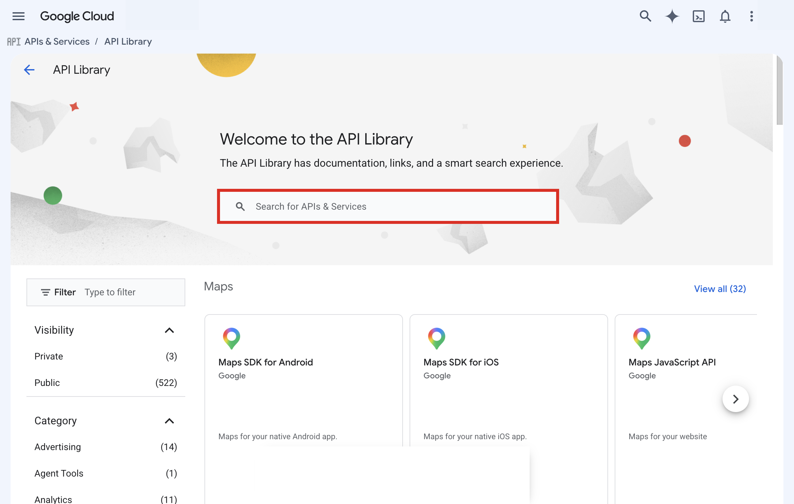
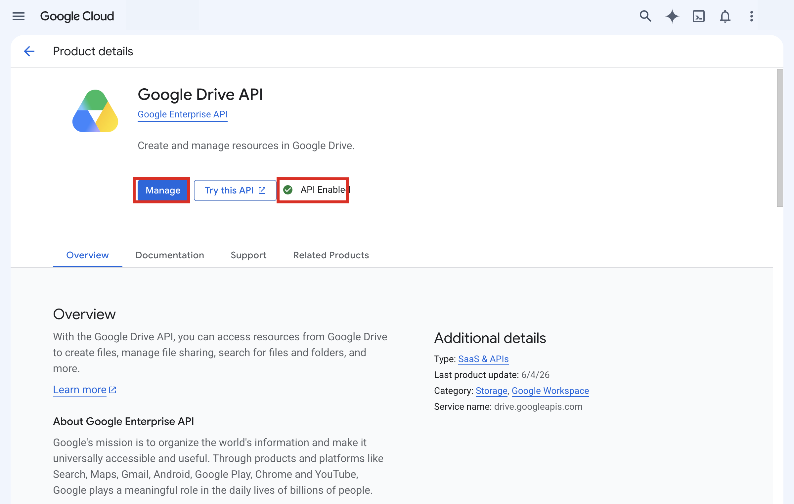
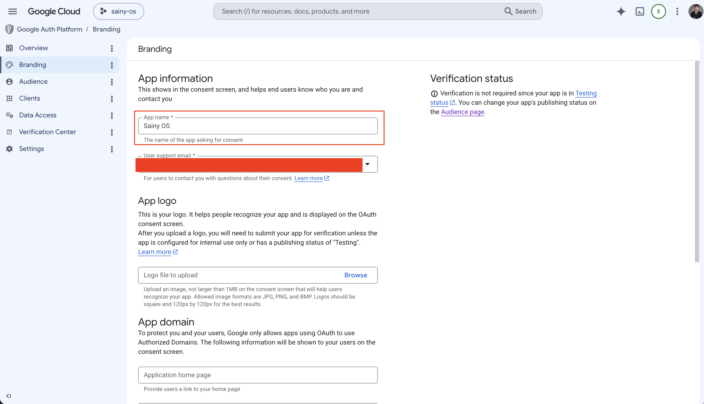
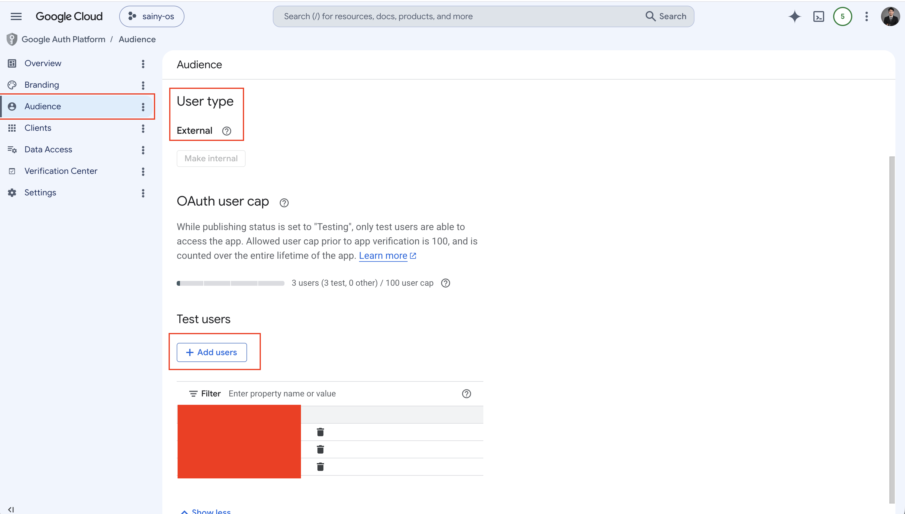
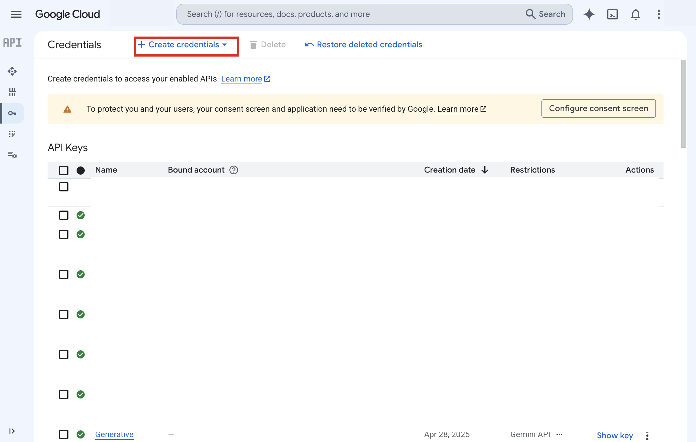
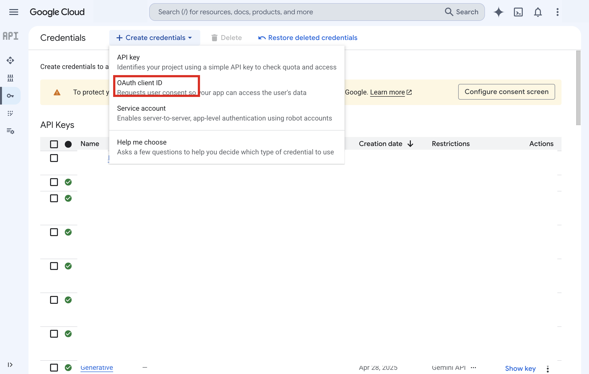
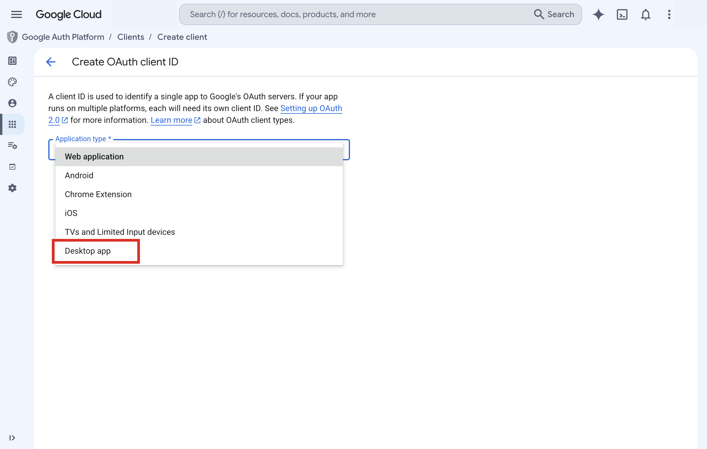
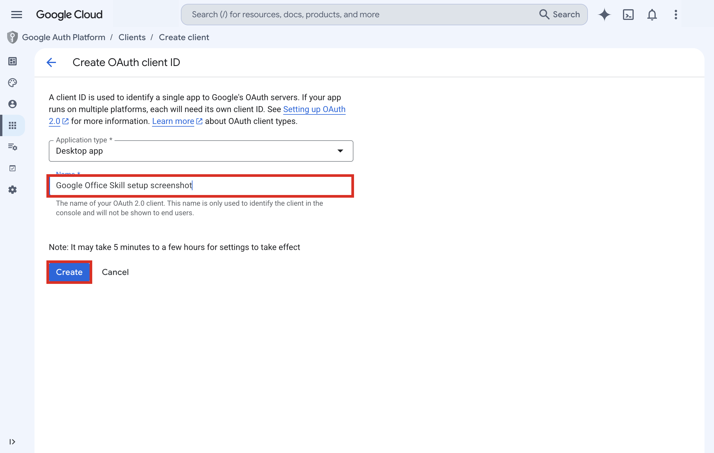
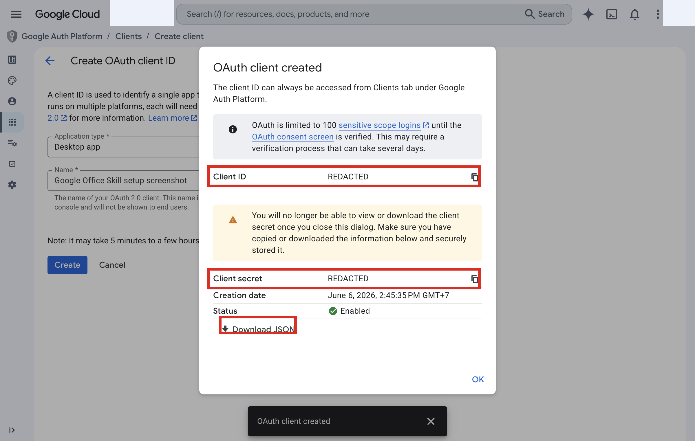

# goog


**Google Workspace from your terminal, across every Google account you use.**

`goog` is a command-line tool for Google Drive, Docs, Sheets, Slides, Calendar and Gmail.
Log in to each of your Google accounts once, then point a command at any file and `goog` finds the account that can open it.
It is built for power users and AI agents such as Claude Code and Codex.

Website: <https://goog.sainytk.com>

> [!NOTE]
> `goog` is an independent open-source project.
> It is not made, endorsed or supported by Google.
> Google, Google Workspace, Gmail, Google Drive, Google Docs, Google Sheets, Google Slides and Google Calendar are trademarks of Google LLC.

## Why goog

- Work, client and personal accounts stay logged in side by side. Point a command at a file and `goog` tries the account that opened it last, then your active account, then the rest, and remembers which one worked. Add `--account` when you want exactly one.
- Commands match everyday tasks. Edit a document by heading or by the text you can see, fill a sheet from a CSV file, or draft a reply to an email. You only write Google API request bodies when you want to.
- Edits in shared files are safe. Preview them with `--dry-run`, write them as suggestions the owner can accept, and anchor comments to the text they discuss. A revision guard refuses the edit when someone changed the file since you last read it.
- Output is a readable table or text by default. Add `--json` for the full result. Progress and update notices go to stderr, so pipes and exit codes keep working.
- You can hand it to an AI agent. Login opens a browser once per account, and ordinary commands never prompt. `goog` only drafts email, so a person always presses send. An agent skill teaches your agent the commands.
- `goog` runs no server. Tokens stay in a private file on your machine, and you sign in through your own Google Cloud OAuth app.

## goog compared with gws

[gws](https://github.com/googleworkspace/cli) is a community Google Workspace CLI published under the `googleworkspace` GitHub organization.
It builds one command for every Google API method from Google's Discovery Service.
`goog` covers six apps with fewer commands, each built for one everyday task, and it is designed around multiple accounts.

| | goog | gws |
| --- | --- | --- |
| Several Google accounts | Log in to each once. Commands find the account that can open the file you pass. | Built-in multi-account support was removed in v0.7.0. One account per config directory. |
| Command style | `goog docs text replace URL --find draft --replace final` | `gws drive files list --params '{"pageSize": 10}'`, mirroring the raw API |
| Editing Google Docs | Insert, replace, style, tables, images, page breaks, headers, footnotes, anchored comments and suggestions | A helper that appends text, plus raw API calls |
| Default output | Readable tables and text, `--json` on request | JSON |
| Edits in other people's files | Suggestions, comments anchored to text and revision guards, one flag each | Through raw API requests |
| Sending email | Drafts only, so a person sends | Can send email |
| Apps covered | Drive, Docs, Sheets, Slides, Calendar, Gmail | Every API in Google's Discovery Service |

Choose gws when you need a Google API outside these six apps, service accounts, or Workspace admin tasks.
Choose `goog` when you juggle several accounts or want an agent to edit documents safely.
This comparison reflects the gws README and issue tracker as of November 2026.

## Install

macOS or Linux:

```sh
curl -fsSL https://raw.githubusercontent.com/SainyTK/goog-cli/main/install.sh | sh
```

Windows (PowerShell):

```powershell
irm https://raw.githubusercontent.com/SainyTK/goog-cli/main/install.ps1 | iex
```

Add the agent skill to Claude Code, Codex and other agents that read skills:

```sh
npx skills add SainyTK/goog-cli
```

The installers download a published release and check its SHA-256 checksum before installing.
`goog` tells you on stderr when a newer release is out, together with the command that updates it.

## Get started

`goog` signs in through an OAuth app in your own Google Cloud project, so your tokens never pass through anyone else's server.
Setting it up takes about ten minutes, once.

1. Follow the [setup guide](https://goog.sainytk.com/setup/) to enable the six Google APIs and create a **Desktop app** OAuth client. Download its JSON file.
2. Add the OAuth app to `goog`:

   ```sh
   goog auth setup --client-secret-file ~/Downloads/client_secret_*.json
   ```

3. Log in to each Google account you use. Each login opens one consent screen:

   ```sh
   goog auth login
   ```

4. Start working:

   ```sh
   goog drive ls --limit 20
   goog docs map "https://docs.google.com/document/d/DOCUMENT_ID/edit"
   ```

<details>
<summary>Google Cloud setup with screenshots</summary>

Open <https://console.cloud.google.com>, create a project or select an existing one, then complete the steps below.

**1. Enable the required APIs.**
Go to **APIs & Services -> Library**.



Enable the Google Drive API, Google Docs API, Google Sheets API, Google Slides API, Google Calendar API and Gmail API.
If an API already shows **Manage** with an **API Enabled** badge, skip it.



**2. Configure the OAuth consent screen.**
In a new project, go to **APIs & Services -> OAuth consent screen**.
In the newer layout this may appear under **Google Auth Platform -> Branding**.
Skip this step if the consent screen is already configured.

Choose **External** for personal Google accounts and fill in the required fields:

- **App name**: any descriptive name, such as `My Office Agent`
- **User support email**: your email address
- **Developer contact information**: your email address

All other fields can stay blank.



Click **Save and Continue**.
The app stays in **Testing** mode, so add each Google account you will log in with under **Test users**.



**3. Create OAuth credentials.**
Go to **APIs & Services -> Credentials**, click **+ Create credentials** and select **OAuth client ID**.





**4. Choose Desktop app.**
Set **Application type** to **Desktop app**, enter any name and click **Create**.





**5. Save the client.**
Click **Download JSON** and pass the file to `goog auth setup --client-secret-file`.
You can also copy the **Client ID** (ending in `.apps.googleusercontent.com`) and **Client secret** (usually starting with `GOCSPX-`) and run `goog auth setup` to paste them.



</details>

### Working with several accounts

```sh
goog auth list
goog auth switch alice@example.com
goog --account bob@example.com drive ls
```

`goog auth switch` changes the active account used by listing and search commands.
`--account` runs one command as exactly that account, with no fallback to the others.

## What you can do

A few everyday commands:

```sh
goog drive upload ./report.pdf --folder FOLDER_ID
goog docs text replace DOCUMENT_ID --find "Q2" --replace "Q3" --dry-run
goog docs text insert DOCUMENT_ID "Reviewed draft. " --at "before-text:The quick" --suggest
goog docs comment-create DOCUMENT_ID --text "Please check this number." --quote "revenue grew 12%"
goog sheets values get-table SPREADSHEET_ID 'Sheet1!A1:D10' --format csv
goog sheets values append-row SPREADSHEET_ID 'Sheet1!A:D' --value Ada --value Lovelace
goog slides replace-text PRESENTATION_ID --find "{{client_name}}" --replace "Acme Co."
goog calendar events quick-add primary "Lunch with Sam tomorrow at noon"
goog mail list 'from:alerts@example.com newer_than:7d'
goog mail draft --reply-to MESSAGE_ID --body 'Thanks, I will review it today.'
```

Docs, Slides and Gmail commands also accept the link you copied from the browser in place of an ID.
Run `goog --help` or `goog <command> --help` for the full reference.
The sections below list more examples for each app.

### Examples by app

<details>
<summary>Google Drive</summary>

```sh
goog drive ls --limit 20
goog drive ls --type folders --folder FOLDER_ID --json
goog drive ls --show-all
goog drive ls --name "Meeting Notes" --type folders
goog drive drives
goog drive info FILE_ID
goog drive upload ./report.pdf --folder FOLDER_ID
goog drive update FILE_ID ./report-v2.pdf --expect-modified-time 2026-01-31T09:15:00.000Z
goog drive revisions FILE_ID
goog drive move FILE_ID --to FOLDER_ID
goog drive convert OFFICE_FILE_ID --to google-doc
goog drive convert OFFICE_FILE_ID --to google-sheet
goog drive convert OFFICE_FILE_ID --to google-doc --folder FOLDER_ID
goog drive trash FILE_ID
goog drive download FILE_ID --output ./report.pdf
goog drive comments FILE_ID
goog drive comments FILE_ID --open
goog drive comment-create FILE_ID --text "Please review." --mention reviewer@example.com
goog drive comment-edit FILE_ID --comment-id COMMENT_ID --text "Updated comment."
goog drive comment-reply FILE_ID --comment-id COMMENT_ID --text "Updated as requested." --mention owner@example.com
goog drive comment-resolve FILE_ID --comment-id COMMENT_ID --text "Addressed."
goog drive comment-delete FILE_ID --comment-id COMMENT_ID
```

`drive update` uploads new content into an existing uploaded file, so its ID and links stay the same and Drive keeps the previous version.
It keeps the Drive name and MIME type unless `--name` or `--mime-type` is given, and `--expect-modified-time` or `--expect-md5` refuses the update when someone changed the file since you last read it.
`drive revisions` lists the stored versions of an uploaded file.
`drive ls --name` keeps items whose name contains the text.
Without `--folder` it searches My Drive, shared drives and items shared with you.
`drive drives` lists the shared drives you belong to, and a shared drive ID works as a `--folder` ID to browse that drive's root.
`drive info` shows one item's name, MIME type, parent folder IDs, shared drive ID and link, so you can walk up from a known folder to its shared drive.
Drive listings exclude soft-deleted items by default.
Use `--show-all` to include them.
`drive comments` fetches every comment page and emits one JSON object containing comments and their replies.
Use `--open` to keep only unresolved comments.
Comments are Drive resources, so the commands work with Google Docs, Sheets, Slides, and other supported Drive files.
`comment-create` creates an unanchored comment; use `docs comment-create` to anchor a comment to Document text.
Repeat `--mention EMAIL` to prefix email mentions.
Include ordinary emoji directly in `--text` when desired.
`comment-resolve` accepts an optional reply, while `comment-delete` permanently removes the comment.

</details>

<details>
<summary>Google Docs</summary>

```sh
goog docs list --limit 20
goog docs create "Q3 Report"
goog docs create "Q3 Report" --folder FOLDER_ID
goog docs export-text DOCUMENT_ID
goog docs copy SOURCE_DOCUMENT_ID "Q3 Report from template"
goog docs copy SOURCE_DOCUMENT_ID "Q3 Report from template" --folder FOLDER_ID
goog docs export-pdf DOCUMENT_ID --output ./q3-report.pdf
goog docs map DOCUMENT_ID
goog docs map DOCUMENT_ID --type images
goog docs map DOCUMENT_ID --type tables
goog docs map DOCUMENT_ID --heading "Summary"
goog docs text search DOCUMENT_ID "quarterly plan"
goog docs text replace DOCUMENT_ID --find "lazy dog" --replace "sleepy cat" --suggest
goog docs text insert DOCUMENT_ID "Reviewed draft. " --at "before-text:The quick" --suggest
goog docs suggestions DOCUMENT_ID --open
goog docs suggestion-accept DOCUMENT_ID --suggestion-id SUGGESTION_ID
goog docs suggestion-reject DOCUMENT_ID --all
goog docs suggestion-delete DOCUMENT_ID --suggestion-id SUGGESTION_ID
goog docs style copy-named SOURCE_DOCUMENT_ID TARGET_DOCUMENT_ID --dry-run
goog docs style copy-page SOURCE_DOCUMENT_ID TARGET_DOCUMENT_ID --dry-run
goog docs image insert DOCUMENT_ID "https://example.test/chart.png" --at 'heading:Summary'
goog docs image insert DOCUMENT_ID "https://example.test/chart.png" --max-width 468 --max-height 500 --at 'heading:Summary'
goog docs image insert DOCUMENT_ID "https://example.test/chart.png" --fit-page --reserve-height 72 --at 'heading:Summary'
goog --account alice@example.com docs image insert DOCUMENT_ID --file ./chart.png --staging drive-public --at 'heading:Summary'
goog --account alice@example.com docs image insert DOCUMENT_ID --file ./chart.png --staging-command ./stage-image --at 'heading:Summary'
goog docs break page DOCUMENT_ID --at 'heading:Summary'
goog docs break section DOCUMENT_ID --section-type next-page --at 'heading:Appendix'
goog docs header create DOCUMENT_ID
goog docs footer create DOCUMENT_ID
goog docs footnote insert DOCUMENT_ID --at 'after-text:quarterly plan'
goog docs named-range create DOCUMENT_ID "highlights" --text "quarterly plan"
goog docs named-range delete DOCUMENT_ID --name "highlights"
goog docs comment-create DOCUMENT_ID --text "Changed: rewrote for new hires." --quote "onboarding paragraph"
goog docs comment-create DOCUMENT_ID --text "Kept as is." --quote "paragraph" --match 2
goog docs comment-create DOCUMENT_ID --deleted "Prices were listed here." --text "Moved to the appendix." --quote "Pricing moved to the appendix."
goog docs comment-create DOCUMENT_ID --text "New heading." --from-index 1 --to-index 14 --mention reviewer@example.com
goog docs comments DOCUMENT_ID --open
goog docs comment-reply DOCUMENT_ID --comment-id COMMENT_ID --text "Updated as requested."
goog docs comment-resolve DOCUMENT_ID --comment-id COMMENT_ID --text "Addressed."
goog docs batch-update DOCUMENT_ID --requests ./requests.json
```

`docs comment-create` adds a comment anchored to Document text, the same way a comment added in the Docs editor is anchored.
The text is highlighted, the comment card sits next to it in the margin, and the comments panel shows the quoted text.
Pick the anchor with `--quote TEXT` (plus `--match N` when the text appears more than once), `--from-index` and `--to-index`, `--entry`, or `--page` and `--line`.
To mark removed text, anchor on the neighbouring text that remains and pass `--deleted TEXT`, which starts the comment with `Deleted: "TEXT"`.
Replacing all of the anchored text later detaches the comment, so add comments after the final edit.
`docs comments`, `comment-edit`, `comment-reply`, `comment-resolve`, and `comment-delete` work like the matching `drive` commands.
`drive comment-create` on a Document creates an unanchored comment, which the Docs editor lists under "Original content deleted" without highlighting any text.

`--suggest` on `docs text insert` and `docs text replace` writes the edit as a suggestion, the way Suggesting mode does in the Docs editor.
Inserted text is shown in color, replaced text is struck through, and each change gets a suggestion card in the margin for the owner to accept or reject.
An account with comment access can suggest edits; editing directly needs edit access.
`docs suggestions` lists suggestion threads with their status and a summary such as `Replace: "old" with "new"`, including suggestions made in the Docs editor.
`docs suggestion-accept` and `suggestion-reject` take one or more `--suggestion-id` values or `--all` for every open suggestion.
`docs suggestion-delete` withdraws suggestions you made.
For other kinds of suggested edits, such as style or table changes, set `"writeControl": {"writeMode": "SUGGEST"}` in a `docs batch-update` request body.

Maximum image dimensions preserve the source aspect ratio and do not upscale by default.
`--fit-page` derives the image bounds from the active body section's page size and margins, while `--reserve-height` leaves vertical space for nearby content.
Pageless documents require explicit `--max-width` and `--max-height` values.
Exact `--width` and `--height` values are checked against the source aspect ratio and require `--allow-distortion` when they would change it.
The conversion uses 96 source pixels per inch and 72 Google Docs points per inch, with results rounded to three decimal places.
For JPEG images, EXIF orientations 5 through 8 swap the encoded width and height so fitting uses the displayed orientation.
`goog docs map DOCUMENT_ID --type images --json` reports each image's native point dimensions in `layoutMetadata.size`.
Local images use cleanup-aware Drive public staging by default, or a JSON stdin and stdout adapter when public Drive sharing is unavailable.

</details>

<details>
<summary>Google Sheets</summary>

```sh
goog sheets create "Quarterly Plan"
goog sheets create "Quarterly Plan" --folder FOLDER_ID
goog sheets list --limit 20
goog sheets get SPREADSHEET_ID --fields 'properties.title,sheets.properties'
goog sheets comments SPREADSHEET_ID
goog sheets comments SPREADSHEET_ID --open
goog sheets comment-create SPREADSHEET_ID --text "Please review." --mention reviewer@example.com
goog sheets comment-edit SPREADSHEET_ID --comment-id COMMENT_ID --text "Updated comment."
goog sheets comment-reply SPREADSHEET_ID --comment-id COMMENT_ID --text "Updated as requested."
goog sheets comment-resolve SPREADSHEET_ID --comment-id COMMENT_ID --text "Addressed."
goog sheets comment-delete SPREADSHEET_ID --comment-id COMMENT_ID
goog sheets sheet add SPREADSHEET_ID "Raw Data"
goog sheets sheet rename SPREADSHEET_ID 123456789 "Archive"
goog sheets sheet move SPREADSHEET_ID 123456789 0
goog sheets sheet duplicate SPREADSHEET_ID 123456789 "Archive Copy"
goog sheets sheet copy-to SPREADSHEET_ID 123456789 DESTINATION_SPREADSHEET_ID --title "Archive" --index 0
goog sheets sheet freeze SPREADSHEET_ID 123456789 --rows 1 --columns 2
goog sheets sheet resize SPREADSHEET_ID 123456789 --rows 200 --columns 12
goog sheets sheet auto-resize SPREADSHEET_ID 123456789 --dimension columns --start-index 0 --end-index 5
goog sheets sheet set-dimension-size SPREADSHEET_ID 123456789 --dimension rows --start-index 1 --end-index 3 --pixel-size 28
goog sheets sheet hide-dimension SPREADSHEET_ID 123456789 --dimension columns --start-index 1 --end-index 3
goog sheets sheet unhide-dimension SPREADSHEET_ID 123456789 --dimension columns --start-index 1 --end-index 3
goog sheets sheet group-dimension SPREADSHEET_ID 123456789 --dimension rows --start-index 1 --end-index 10
goog sheets sheet ungroup-dimension SPREADSHEET_ID 123456789 --dimension rows --start-index 1 --end-index 10
goog sheets sheet collapse-dimension-group SPREADSHEET_ID 123456789 --dimension rows --start-index 1 --end-index 10
goog sheets sheet expand-dimension-group SPREADSHEET_ID 123456789 --dimension rows --start-index 1 --end-index 10
goog sheets sheet insert-dimension SPREADSHEET_ID 123456789 --dimension rows --start-index 2 --end-index 4 --inherit-from-before
goog sheets sheet delete-dimension SPREADSHEET_ID 123456789 --dimension columns --start-index 3 --end-index 6
goog sheets sheet basic-filter SPREADSHEET_ID 123456789 --start-row 0 --end-row 100 --start-column 0 --end-column 5
goog sheets sheet clear-basic-filter SPREADSHEET_ID 123456789
goog sheets sheet merge SPREADSHEET_ID 123456789 --start-row 0 --end-row 2 --start-column 0 --end-column 4 --merge-type all
goog sheets sheet unmerge SPREADSHEET_ID 123456789 --start-row 0 --end-row 2 --start-column 0 --end-column 4
goog sheets sheet sort-range SPREADSHEET_ID 123456789 --start-row 1 --end-row 100 --start-column 0 --end-column 5 --sort-column 3 --order descending
goog sheets sheet delete-duplicates SPREADSHEET_ID 123456789 --start-row 1 --end-row 100 --start-column 0 --end-column 5 --comparison-column 1 --comparison-column 3
goog sheets sheet trim-whitespace SPREADSHEET_ID 123456789 --start-row 1 --end-row 100 --start-column 0 --end-column 5
goog sheets sheet randomize-range SPREADSHEET_ID 123456789 --start-row 1 --end-row 100 --start-column 0 --end-column 5
goog sheets sheet find-replace SPREADSHEET_ID "draft" "final" --sheet-id 123456789 --match-case
goog sheets sheet copy-paste SPREADSHEET_ID 123456789 --source-start-row 1 --source-end-row 4 --source-start-column 0 --source-end-column 3 --destination-sheet-id 987654321 --destination-start-row 10 --destination-end-row 13 --destination-start-column 0 --destination-end-column 3 --paste-type values
goog sheets sheet cut-paste SPREADSHEET_ID 123456789 --source-start-row 1 --source-end-row 4 --source-start-column 0 --source-end-column 3 --destination-sheet-id 987654321 --destination-row 10 --destination-column 0 --paste-type values
goog sheets sheet background-color SPREADSHEET_ID 123456789 --start-row 0 --end-row 1 --start-column 0 --end-column 5 "#ffcc00"
goog sheets sheet text-color SPREADSHEET_ID 123456789 --start-row 0 --end-row 1 --start-column 0 --end-column 5 "#3366cc"
goog sheets sheet font-size SPREADSHEET_ID 123456789 --start-row 0 --end-row 1 --start-column 0 --end-column 5 --size 14
goog sheets sheet font-family SPREADSHEET_ID 123456789 --start-row 0 --end-row 1 --start-column 0 --end-column 5 --family Roboto
goog sheets sheet number-format SPREADSHEET_ID 123456789 --start-row 1 --end-row 100 --start-column 3 --end-column 4 --type currency --pattern '$#,##0.00'
goog sheets sheet borders SPREADSHEET_ID 123456789 --start-row 0 --end-row 10 --start-column 0 --end-column 5 --edge outer --style solid-thick --color "#3366cc"
goog sheets sheet clear-format SPREADSHEET_ID 123456789 --start-row 0 --end-row 10 --start-column 0 --end-column 5
goog sheets sheet bold SPREADSHEET_ID 123456789 --start-row 0 --end-row 1 --start-column 0 --end-column 5
goog sheets sheet italic SPREADSHEET_ID 123456789 --start-row 0 --end-row 1 --start-column 0 --end-column 5
goog sheets sheet underline SPREADSHEET_ID 123456789 --start-row 0 --end-row 1 --start-column 0 --end-column 5
goog sheets sheet strikethrough SPREADSHEET_ID 123456789 --start-row 0 --end-row 1 --start-column 0 --end-column 5
goog sheets sheet horizontal-align SPREADSHEET_ID 123456789 --start-row 0 --end-row 1 --start-column 0 --end-column 5 --alignment center
goog sheets sheet vertical-align SPREADSHEET_ID 123456789 --start-row 0 --end-row 1 --start-column 0 --end-column 5 --alignment middle
goog sheets sheet text-wrap SPREADSHEET_ID 123456789 --start-row 0 --end-row 10 --start-column 0 --end-column 5 --strategy wrap
goog sheets sheet text-rotation SPREADSHEET_ID 123456789 --start-row 0 --end-row 1 --start-column 0 --end-column 5 --angle 45
goog sheets sheet text-direction SPREADSHEET_ID 123456789 --start-row 0 --end-row 10 --start-column 0 --end-column 5 --direction right-to-left
goog sheets sheet note SPREADSHEET_ID 123456789 --start-row 1 --end-row 2 --start-column 3 --end-column 4 "Check source data"
goog sheets sheet note SPREADSHEET_ID 123456789 --start-row 1 --end-row 2 --start-column 3 --end-column 4 --clear
goog sheets sheet data-validation-list SPREADSHEET_ID 123456789 --start-row 1 --end-row 100 --start-column 2 --end-column 3 --value Open --value Closed --input-message "Pick a status"
goog sheets sheet data-validation-list SPREADSHEET_ID 123456789 --start-row 1 --end-row 100 --start-column 2 --end-column 3 --clear
goog sheets sheet data-validation-checkbox SPREADSHEET_ID 123456789 --start-row 1 --end-row 100 --start-column 0 --end-column 1 --input-message "Mark done"
goog sheets sheet data-validation-checkbox SPREADSHEET_ID 123456789 --start-row 1 --end-row 100 --start-column 0 --end-column 1 --checked-value Done --unchecked-value Todo
goog sheets sheet data-validation-checkbox SPREADSHEET_ID 123456789 --start-row 1 --end-row 100 --start-column 0 --end-column 1 --clear
goog sheets sheet conditional-format-color SPREADSHEET_ID 123456789 --start-row 1 --end-row 100 --start-column 3 --end-column 4 --condition number-greater --value 100 --background-color "#ffcccc"
goog sheets sheet conditional-format-update SPREADSHEET_ID 123456789 0 --start-row 1 --end-row 100 --start-column 3 --end-column 4 --condition text-contains --value Blocked --background-color "#ffeeee"
goog sheets sheet conditional-format-delete SPREADSHEET_ID 123456789 0
goog sheets sheet conditional-format-move SPREADSHEET_ID 123456789 2 0
goog sheets sheet protect-range SPREADSHEET_ID 123456789 --start-row 0 --end-row 1 --start-column 0 --end-column 5 --description "Lock headers"
goog sheets sheet protect-range SPREADSHEET_ID 123456789 --start-row 1 --end-row 100 --start-column 0 --end-column 5 --warning-only
goog sheets sheet add-named-range SPREADSHEET_ID 123456789 HeaderCells --start-row 0 --end-row 1 --start-column 0 --end-column 5
goog sheets sheet delete-named-range SPREADSHEET_ID header_cells
goog sheets sheet update-named-range SPREADSHEET_ID header_cells --name HeaderRows --sheet-id 123456789 --start-row 0 --end-row 2 --start-column 0 --end-column 5
goog sheets sheet update-protected-range SPREADSHEET_ID 7 --description "Warn before editing" --warning-only
goog sheets sheet update-protected-range SPREADSHEET_ID 7 --enforce
goog sheets sheet unprotect-range SPREADSHEET_ID 7
goog sheets sheet tab-color SPREADSHEET_ID 123456789 "#3366cc"
goog sheets sheet clear-tab-color SPREADSHEET_ID 123456789
goog sheets sheet hide SPREADSHEET_ID 123456789
goog sheets sheet unhide SPREADSHEET_ID 123456789
goog sheets sheet delete SPREADSHEET_ID 123456789
goog sheets values get SPREADSHEET_ID 'Sheet1!A1:D10'
goog sheets values get-cell SPREADSHEET_ID 'Sheet1!D2' --value-render-option formula
goog sheets values get-row SPREADSHEET_ID 'Sheet1!A2:D2' --value-render-option formula
goog sheets values get-column SPREADSHEET_ID 'Sheet1!D2:D10' --value-render-option unformatted-value
goog sheets values get-table SPREADSHEET_ID 'Sheet1!A1:D10' --value-render-option formula
goog sheets values get-table SPREADSHEET_ID 'Sheet1!A1:D10' --format csv
goog sheets values update SPREADSHEET_ID 'Sheet1!A1' --values ./value-range.json
goog sheets values update-cell SPREADSHEET_ID 'Sheet1!D2' '=SUM(C2:C10)'
goog sheets values update-row SPREADSHEET_ID 'Sheet1!A2:C2' --value Ada --value Lovelace --value '=SUM(C2:C10)'
goog sheets values update-column SPREADSHEET_ID 'Sheet1!D2:D4' --value Open --value Closed --value Blocked
goog sheets values update-table SPREADSHEET_ID 'Sheet1!A1:D10' --data ./rows.csv
cat rows.csv | goog sheets values update-table SPREADSHEET_ID 'Sheet1!A1:D10' --data - --format csv
goog sheets values append SPREADSHEET_ID 'Sheet1!A:D' --values ./rows.json
goog sheets values append-row SPREADSHEET_ID 'Sheet1!A:D' --value Ada --value Lovelace --value '=SUM(C2:C10)'
goog sheets values append-column SPREADSHEET_ID 'Sheet1!A:D' --value Open --value Closed --value Blocked
goog sheets values append-table SPREADSHEET_ID 'Sheet1!A:D' --data ./rows.csv
cat rows.tsv | goog sheets values append-table SPREADSHEET_ID 'Sheet1!A:D' --data - --format tsv
```

</details>

<details>
<summary>Google Slides</summary>

```sh
goog slides list --limit 20
goog slides create "Quarterly Review"
goog slides create "Quarterly Review" --folder FOLDER_ID
goog slides get PRESENTATION_ID
goog slides get PRESENTATION_ID --fields 'presentationId,title,slides(objectId)' --json
goog slides comments PRESENTATION_ID
goog slides comments PRESENTATION_ID --open
goog slides comment-create PRESENTATION_ID --text "Please review." --mention reviewer@example.com
goog slides comment-edit PRESENTATION_ID --comment-id COMMENT_ID --text "Updated comment."
goog slides comment-reply PRESENTATION_ID --comment-id COMMENT_ID --text "Updated as requested."
goog slides comment-resolve PRESENTATION_ID --comment-id COMMENT_ID --text "Addressed."
goog slides comment-delete PRESENTATION_ID --comment-id COMMENT_ID
goog slides slide create PRESENTATION_ID --layout title-and-body --object-id agenda-slide
goog slides slide duplicate PRESENTATION_ID SLIDE_OBJECT_ID --object-id copied-slide --insertion-index 1
goog slides slide move PRESENTATION_ID --page-id SLIDE_OBJECT_ID --insertion-index 1
goog slides slide background PRESENTATION_ID SLIDE_OBJECT_ID --color "#fbbc04"
goog slides slide delete PRESENTATION_ID SLIDE_OBJECT_ID
goog slides text-box PRESENTATION_ID --page-id SLIDE_OBJECT_ID --text "Executive summary" --x 72 --y 72 --width 360 --height 120
goog slides image PRESENTATION_ID --page-id SLIDE_OBJECT_ID --url https://example.com/chart.png --x 72 --y 216 --width 360 --height 240
goog slides video PRESENTATION_ID --page-id SLIDE_OBJECT_ID --video-id dQw4w9WgXcQ --x 72 --y 216 --width 360 --height 240
goog slides object replace-image PRESENTATION_ID IMAGE_OBJECT_ID --url https://example.com/new-chart.png --method center-crop
goog slides table PRESENTATION_ID --page-id SLIDE_OBJECT_ID --rows 4 --columns 3 --x 72 --y 72 --width 360 --height 180
goog slides table-fill PRESENTATION_ID TABLE_OBJECT_ID --row "Metric|Value" --row 'ARR|$1.2M'
goog slides table-insert-rows PRESENTATION_ID TABLE_OBJECT_ID --reference-row 1 --number 2 --below
goog slides table-delete-row PRESENTATION_ID TABLE_OBJECT_ID --reference-row 1
goog slides table-insert-columns PRESENTATION_ID TABLE_OBJECT_ID --reference-column 1 --number 2 --right
goog slides table-delete-column PRESENTATION_ID TABLE_OBJECT_ID --reference-column 1
goog slides table-merge-cells PRESENTATION_ID TABLE_OBJECT_ID --start-row 0 --start-column 0 --row-span 1 --column-span 2
goog slides table-unmerge-cells PRESENTATION_ID TABLE_OBJECT_ID --start-row 0 --start-column 0 --row-span 1 --column-span 2
goog slides shape PRESENTATION_ID --page-id SLIDE_OBJECT_ID --type round-rectangle --x 72 --y 72 --width 240 --height 96
goog slides line PRESENTATION_ID --page-id SLIDE_OBJECT_ID --category straight --x 72 --y 72 --width 240 --height 0
goog slides object style PRESENTATION_ID PAGE_OBJECT_ID --fill-color "#1a73e8" --outline-color "#202124" --outline-weight 2
goog slides object line-style PRESENTATION_ID LINE_OBJECT_ID --color "#1a73e8" --weight 3
goog slides object insert-text PRESENTATION_ID PAGE_OBJECT_ID --text "Updated takeaway" --index 0
goog slides object delete-text PRESENTATION_ID PAGE_OBJECT_ID --start-index 0 --end-index 7
goog slides object text-style PRESENTATION_ID PAGE_OBJECT_ID --color "#202124" --font-family Georgia --font-size 18 --bold --italic false --start-index 0 --end-index 17
goog slides object alt-text PRESENTATION_ID PAGE_OBJECT_ID --title "Pipeline chart" --description "Bar chart showing qualified pipeline by stage"
goog slides object move PRESENTATION_ID PAGE_OBJECT_ID --x 96 --y 144 --scale-x 1.2 --scale-y 1.2
goog slides object order PRESENTATION_ID --object-id PAGE_OBJECT_ID --operation bring-to-front
goog slides object group PRESENTATION_ID --object-id SHAPE_OBJECT_ID --object-id IMAGE_OBJECT_ID --group-id hero-group
goog slides object ungroup PRESENTATION_ID --object-id hero-group
goog slides replace-text PRESENTATION_ID --find "{{client_name}}" --replace "Acme Co." --page-id SLIDE_OBJECT_ID
goog slides object delete PRESENTATION_ID PAGE_OBJECT_ID
goog slides batch-update PRESENTATION_ID --requests ./slides-requests.json
```

</details>

<details>
<summary>Google Calendar</summary>

```sh
goog calendar calendars list --limit 20
goog calendar calendars get primary
goog calendar calendars create --summary "Team Launches" --time-zone Asia/Bangkok --description "Launch planning calendar"
goog calendar calendars update team-launches@example.com --summary "Team Launches Updated" --time-zone Asia/Bangkok --description "Launch planning and retros"
goog calendar calendars patch team-launches@example.com --description "Launch planning, retros, and launch notes"
goog calendar calendars list-entry add team-launches@example.com --summary-override "Launches" --selected true --color-id 2
goog calendar calendars list-entry get team-launches@example.com
goog calendar calendars list-entry update team-launches@example.com --summary-override "Launches" --selected true --color-id 2 --default-reminder popup:10
goog calendar calendars list-entry patch team-launches@example.com --summary-override "Launches" --selected true --color-id 2 --default-reminder popup:10
goog calendar calendars list-entry delete team-launches@example.com
goog calendar calendars delete team-launches@example.com
goog calendar colors get
goog calendar acl list team-launches@example.com --limit 20
goog calendar acl get team-launches@example.com user:teammate@example.com
goog calendar acl add team-launches@example.com --scope user --value teammate@example.com --role writer --no-send-notifications
goog calendar acl update team-launches@example.com user:teammate@example.com --scope user --value teammate@example.com --role writer
goog calendar acl patch team-launches@example.com user:teammate@example.com --role reader
goog calendar acl delete team-launches@example.com user:teammate@example.com
goog calendar freebusy --time-min 2026-07-09T09:00:00Z --time-max 2026-07-09T17:00:00Z --calendar primary --calendar teammate@example.com
goog calendar events list primary --time-min 2026-07-09T00:00:00Z --time-max 2026-07-10T00:00:00Z --time-zone Asia/Bangkok --single-events
goog calendar events list primary --updated-min 2026-07-08T00:00:00Z --show-deleted --show-hidden-invitations --order-by updated --json
goog calendar events list primary --sync-token NEXT_SYNC_TOKEN --json
goog calendar events list primary --i-cal-uid abc123@example.com --json
goog calendar events list primary --private-extended-property owner=agent --shared-extended-property project=alpha --json
goog calendar events list primary --event-type out-of-office --event-type working-location --max-attendees 3 --json
goog calendar events get primary EVENT_ID
goog calendar events get primary EVENT_ID --json
goog calendar events instances primary RECURRING_EVENT_ID --time-min 2026-07-09T00:00:00Z --time-max 2026-07-30T00:00:00Z
goog calendar events create primary --summary "Planning" --start 2026-07-09T09:00:00+07:00 --end 2026-07-09T09:30:00+07:00 --time-zone Asia/Bangkok --attendee teammate@example.com --recurrence "RRULE:FREQ=WEEKLY;COUNT=4" --reminder popup:10 --color-id 5 --google-meet --send-updates all
goog calendar events create primary --summary "Out of office" --start 2026-07-09 --end 2026-07-10 --all-day
goog calendar events create primary --event ./event.json
goog calendar events import primary --summary "Imported planning" --start 2026-07-09T09:00:00+07:00 --end 2026-07-09T09:30:00+07:00 --time-zone Asia/Bangkok
goog calendar events import primary --event ./event.json
goog calendar events quick-add primary "Lunch with Sam tomorrow at noon" --send-updates none
goog calendar events update primary EVENT_ID --summary "Planning moved" --start 2026-07-09T10:00:00+07:00 --end 2026-07-09T10:30:00+07:00 --time-zone Asia/Bangkok --send-updates external-only
goog calendar events update primary EVENT_ID --event ./event.json
goog calendar events patch primary EVENT_ID --summary "Planning renamed" --location "Office" --color-id 7 --google-meet --meet-request-id planning-meet-1 --no-reminders --send-updates none
goog calendar events move primary EVENT_ID --destination team@example.com
goog calendar events delete primary EVENT_ID --send-updates all
```

</details>

<details>
<summary>Gmail</summary>

```sh
goog mail list --limit 10
goog mail list 'from:alerts@example.com newer_than:7d'
goog mail read MESSAGE_ID
goog mail draft --to teammate@example.com --subject 'Status update' --body @./message.txt --attachment ./report.pdf
goog mail draft --to teammate@example.com --subject 'Rich update' --body '<p><strong>Important</strong>: <mark>review today</mark></p>' --html
goog mail draft --reply-to MESSAGE_ID --body 'Thanks, I will review it today.'
goog mail drafts 'subject:status'
goog mail read-draft DRAFT_ID
goog mail draft DRAFT_ID --body @./revised.txt
goog mail draft DRAFT_ID --add-cc lead@example.com --remove-attachment old-report.pdf
goog mail download MESSAGE_ID ATTACHMENT_ID --output invoice.pdf
```

</details>

## Use with AI agents

Install the skill with `npx skills add SainyTK/goog-cli`, then ask your agent for the result you want, such as "summarize the open comments in this doc" or "add last week's numbers to the tracker sheet".
The skill in [`skills/goog`](skills/goog) documents the same commands as the CLI and adds no hidden behavior.

A few things make `goog` predictable for agents:

- Ordinary commands never open a browser or wait for input.
- Progress bars and notices go to stderr, so stdout and `--json` output stay parseable.
- Ambiguous targets are refused with the candidate matches listed, so an agent never edits the wrong paragraph.
- `goog` creates and edits Gmail drafts but never sends them.

Treat anything an agent reads from a document or email as untrusted input, and review drafts and shared-file edits before they go out.

## Privacy and security

- `goog` talks only to Google's APIs, GitHub (to check for new releases) and PostHog (usage counts, described below).
- Tokens live in `~/.goog/auth.json` (`%USERPROFILE%\.goog\auth.json` on Windows), readable only by your user on macOS and Linux. Anyone who can read that file can act as your accounts, so never commit it or sync it to places you do not trust.
- Login uses your own OAuth app with PKCE. No token passes through a `goog` server, because there is none.
- Inserting a local image into a Google Doc uploads it to your Drive, shares it with anyone who has the link while Docs copies it, then deletes it. Use `--staging-command` to stage images on your own host instead.

### Usage telemetry

Release builds send one usage event per command to PostHog so maintainers can see which commands people use.
The first run prints a notice and sends nothing.
The notice is shown again once whenever its wording changes.
Each event holds the command name (such as `drive ls`), the result, the exit code, the duration, the local hour and weekday, the `goog` version, and the operating system.
Devices are identified by a random ID in `~/.goog/telemetry.json`.
Accounts are identified by a one-way hash of Google's internal account number, so one account counts as one account on every device.
Arguments, file and resource IDs, file contents and email addresses are never sent.
Source builds, CI runs and test runs send nothing.

Turn telemetry off with any of these:

- `GOOG_TELEMETRY=off`
- `DO_NOT_TRACK=1`
- `telemetry = false` under `[settings]` in `~/.goog/config.toml`

## Limitations

- `goog` cannot write to Office files (`.xlsx`, `.docx`) stored in Drive, because the Sheets and Docs APIs cannot write to them. Convert the file first with `goog drive convert FILE_ID --to google-sheet` or `--to google-doc`.
- `goog` covers Drive, Docs, Sheets, Slides, Calendar and Gmail. Other Workspace apps and Workspace administration are out of scope for now.
- When Google's API cannot do something, `goog` says so and leaves it undone. It never automates the browser.

## More install options

The installer script installs the latest stable release.
It installs to `/usr/local/bin` when that directory is writable, otherwise to `$HOME/.local/bin`, and warns if that directory is missing from your PATH.
Release builds cover macOS (Apple silicon and Intel), Linux (x64 and arm64) and Windows x64.

Install the latest preview release or a specific version:

```sh
curl -fsSL https://raw.githubusercontent.com/SainyTK/goog-cli/main/install.sh | sh -s -- --channel preview
curl -fsSL https://raw.githubusercontent.com/SainyTK/goog-cli/main/install.sh | sh -s -- --version v0.2.17
```

On Windows, `install.ps1` installs to `$env:LOCALAPPDATA\Programs\goog\bin` and adds it to your user PATH, so open a new terminal after the first install.
Piping into `iex` cannot forward arguments, so pass options through a script block:

```powershell
& ([scriptblock]::Create((irm https://raw.githubusercontent.com/SainyTK/goog-cli/main/install.ps1))) -Channel preview
& ([scriptblock]::Create((irm https://raw.githubusercontent.com/SainyTK/goog-cli/main/install.ps1))) -Version v0.2.17
```

`install.ps1` also accepts `-InstallDir` and `-NoPathUpdate`, and reads `GOOG_CHANNEL`, `GOOG_VERSION`, `GOOG_INSTALL_DIR` and `GOOG_NO_MODIFY_PATH`.

On other platforms, build from source with Cargo:

```sh
cargo install --git https://github.com/SainyTK/goog-cli goog
```

`goog version --json` shows which release produced the installed binary.
For a published release, `sourceTag` and `gitCommit` match the GitHub Release, `releaseChannel` is `stable` or `preview`, and `dirty` is `false`.

### Uninstall

Remove the binary from wherever it was installed:

```sh
rm -f /usr/local/bin/goog "$HOME/.local/bin/goog"
```

```powershell
Remove-Item -Recurse -Force "$env:LOCALAPPDATA\Programs\goog"
```

If you installed with Cargo, run `cargo uninstall goog`.
To remove your accounts and settings too, delete `~/.goog` (`%USERPROFILE%\.goog` on Windows).

## Contributing

Contributions are welcome.
Read [VISION.md](VISION.md) before proposing a feature or opening a pull request.
It explains which changes `goog` accepts and which it resists.

### Development setup

`goog` is a single Rust crate.
Install a stable Rust toolchain, then:

```sh
git clone https://github.com/SainyTK/goog-cli
cd goog-cli
cargo build
./target/debug/goog --help
```

Run the same checks as CI before opening a pull request:

```sh
cargo fmt --check
cargo check --all-targets
cargo test
```

The `CI` workflow runs them on Linux and Windows for every push and pull request.

### Pull requests

- Describe the user-facing change in a few lines.
- Verify new or changed Google API behavior against a real Google account, using throwaway files you delete afterwards.
- Add tests with recorded HTTP fixtures and obvious placeholder IDs. Never commit real document IDs, URLs or email addresses.
- Update this README and the command help when commands, OAuth behavior or installation change.
- Keep GitHub Releases as the only place binaries are published.

### Releases

Maintainers publish releases by pushing tags, and the `Canonical Release` workflow does the rest.
It checks that the tag sits on the right branch, builds every platform, smoke-tests each archive, and uploads the archives with SHA-256 checksums.

Before tagging, bump the version in `Cargo.toml`, let Cargo update `Cargo.lock`, and run:

```sh
cargo fmt --check
cargo test
cargo test --test distribution_artifacts_tests
```

A preview release comes from the `preview` branch:

```sh
git push origin develop
git push origin HEAD:preview
git tag v0.2.18-preview.1
git push origin v0.2.18-preview.1
```

A stable release comes from `main` once the preview is tested and the version is bumped to the stable number:

```sh
git push origin HEAD:main
git tag v0.2.18
git push origin v0.2.18
```

After publishing, install the release into a temporary directory with the installer script and run `goog --version`.

## License

`goog` is released under the [MIT License](LICENSE).

## Disclaimer

`goog` is an independent project and is not affiliated with, endorsed by or supported by Google LLC.
Use it with Google accounts you are allowed to access, and follow your organization's policies for third-party tools.
Google and the Google app names are trademarks of Google LLC.
